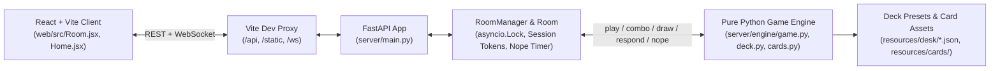

# Exploding Kitty

[](https://github.com/DangTAnh/projectEK/actions/workflows/ci.yml)


A real-time multiplayer browser implementation of **Exploding Kittens** for **2–9 players**, powered by a pure-Python deterministic game engine, **FastAPI + WebSockets**, and a **React + Vite** studio interface.

---

## Key Engineering Highlights

- **Decoupled Synchronous Game Engine (`server/engine/`):**
  - Pure-Python state machine isolated from transport and framework concerns, supporting **45 card types** across **13 deck editions** (`resources/desk/*.json`).
  - Continuation-based prompt resolution (`_ask` / `Game.respond`) for multi-step card interactions (Defuse placement, Alter/Share/Reveal the Future, Favor, Blind/Curse of the Cat Butt, Mark, Zombie Kittens, Godcat, Armageddon, etc.).
  - Per-player state projection (`Game.view(name)`) enforces information hiding so opponents never receive private hands, hidden deck order, or secret pending prompts.
- **Resilient Real-Time Room & WebSocket Layer (`server/rooms.py`, `server/main.py`):**
  - Per-room `asyncio.Lock` serializes state transitions; failed socket broadcasts clean up stale connections without blocking the room (`SEND_TIMEOUT = 5.0`s).
  - Unguessable session tokens enable safe reconnects by player name and clean tab-takeover handling (`TAKEOVER_CLOSE_CODE = 4001`), alongside IP rate-limiting on room creation and automatic room/lobby TTL pruning.
  - Non-blocking **2-second Nope reaction window** (`NOPE_SECONDS = 2`) managed via async timers that cancel or reset cleanly when players stack `Nope` or pass (`pass_nope`).
  - Graceful disconnect notification wrapped in `asyncio.shield` so leaving players still update lobby rosters cleanly under task cancellation.
- **Interactive React + Vite Studio UI (`web/src/`):**
  - Custom tabletop UI with drag-to-reorder cards (both on-turn and off-turn), drag-to-play onto the discard pile, card inspection modal, customizable SVG Exploding Kittens-style cat avatars (`CatAvatar`), and procedural Web Audio sound effects (`sfx.js`).
  - Deck-anchored draw animations, discard pile scatter physics, card-transfer VFX, turn-indicator direction strip with auto-scroll, and dramatic overlays (`BoomOverlay`, `ActionCutscene`, `CardSlamHand`).
  - **Sliding-Window Log Animation Invariant:** Server sends only `log[-30:]`; the frontend tracks the last seen log line content rather than array length/index so animations never drift or drop after log truncation.
  - Opt-in **Debug Studio** (`EK_DEBUG=1` + `?debug=1`) for deterministic scenario setup and visual inspection.
- **Automated Verification & CI:**
  - **163 pytest tests** covering card rules, edge-case engine interactions, session/reconnect security, and in-process FastAPI `TestClient` REST/WebSocket flows.
  - GitHub Actions CI pipeline running Python 3.11 & 3.12 test matrices plus Vite production builds on every push and pull request.

---

## Architecture



---

## Tech Stack

| Layer | Technology |
|---|---|
| **Backend API & Realtime** | Python 3.11+, FastAPI, Uvicorn, WebSockets, `asyncio` |
| **Game Engine** | Pure Python state machine (`dataclasses`, continuation callbacks) |
| **Frontend** | React 18, Vite 5, CSS animations, Web Audio API |
| **Testing & CI** | Pytest (`faulthandler_timeout = 60`), FastAPI `TestClient`, GitHub Actions |

---

## Project Structure

```text
.
├── .github/workflows/ci.yml   # GitHub Actions: Python 3.11/3.12 pytest + Vite build
├── server/
│   ├── main.py                # FastAPI entrypoint, REST routes, WebSocket lifecycle
│   ├── rooms.py               # RoomManager, session auth, desk voting, Nope timer
│   └── engine/
│       ├── cards.py           # 45 card types metadata (CARD_META, Godcat/rescue rules)
│       ├── deck.py            # Deck loading & top/bottom/insertion mechanics
│       ├── game.py            # Synchronous state machine & per-player view()
│       └── player.py          # Player hand, alive state, and status flags
├── web/
│   ├── src/
│   │   ├── Home.jsx           # Lobby browser, room creation/join
│   │   ├── Room.jsx           # Gameplay UI, WebSocket client, drag/drop & animations
│   │   ├── DebugStudio.jsx    # Opt-in debug console (EK_DEBUG=1)
│   │   ├── components/        # CardView, CatAvatar, PendingPanel, NopeBar, overlays
│   │   └── utils/             # Card catalog helpers, avatar presets, Web Audio SFX
│   ├── public/ui/             # Custom UI icons & animation sprites
│   └── vite.config.js         # Local proxy (/api, /static, /ws -> :8000)
├── resources/
│   ├── desk/                  # 13 playable deck edition JSON configs
│   ├── cards/                 # Card artwork served at /static/cards
│   └── cards_desc/            # Card rules & mechanics descriptions
├── tests/
│   ├── test_engine.py         # Core gameplay & card rule test suite
│   ├── test_bugfixes_engine.py# Engine edge-case regressions
│   ├── test_bugfixes_transport.py # Room, session token & WebSocket boundary tests
│   ├── test_bugfixes.py       # Cross-cutting bugfix regressions
│   └── test_server.py         # End-to-end REST & WebSocket smoke tests
├── requirements.txt           # Backend runtime dependencies
├── requirements-dev.txt       # Backend test dependencies
└── pytest.ini                 # Pytest timeout watchdog configuration
```

---

## Getting Started

### Prerequisites

- **Python** 3.11+
- **Node.js** 18+ (20+ recommended) & **npm**

### 1. Run the Backend (`localhost:8000`)

```bash
pip install -r requirements.txt
uvicorn server.main:app --reload
```

> To enable Debug Studio & `/api/debug/*` routes locally, set `EK_DEBUG=1` before launching `uvicorn`.

### 2. Run the Frontend (`localhost:5173`)

```bash
cd web
npm install
npm run dev
```

Vite automatically proxies `/api`, `/static`, and `/ws` requests to `http://localhost:8000`. Open `http://localhost:5173` in two or more browser tabs/windows to play.

---

## Running Tests

```bash
pip install -r requirements-dev.txt
pytest -v
```

| Test Suite | Scope |
|---|---|
| `tests/test_engine.py` | Dealing, turns, bombs/rescue, Nope stacking, combos, pending decisions, view privacy |
| `tests/test_bugfixes_engine.py` | Stacked attacks, Armageddon, Clone, Garbage Collection, Swap Top/Bottom privacy |
| `tests/test_bugfixes_transport.py` | `Room`/`RoomManager` capacity, session tokens, disconnect broadcasts |
| `tests/test_bugfixes.py` | Malformed payloads, reconnects, chronological logs, card image URLs |
| `tests/test_server.py` | FastAPI `TestClient` REST & multi-client WebSocket lobby/start flow |

To verify the frontend production bundle:

```bash
npm --prefix web run build
```

---

## API & WebSocket Reference

### REST Endpoints

| Method | Path | Description |
|---|---|---|
| `GET` | `/api/health` | Service health check, active room count, debug flag status |
| `POST` | `/api/rooms` | Create a new 4-character room (rate-limited per IP) |
| `GET` | `/api/rooms` | List active rooms (`code`, `player_count`, `max_players`, `phase`) |
| `GET` | `/api/rooms/{code}` | Inspect room summary metadata |
| `GET` | `/api/desks` | List available deck edition keys |
| `GET` | `/api/desks/details` | Detailed metadata for all 13 deck editions |
| `GET` | `/api/cards` | Full card catalog metadata, categories, descriptions, and artwork URLs |

### WebSocket Protocol (`/ws/{code}?name=...&token=...`)

- **Server → Client:** `{ "type": "state", "view": { ... } }` (sanitized per player) or `{ "type": "error", "code": "...", "message": "..." }`.
- **Client → Server:** `{ "action": "<action>", ... }` supporting:
  - Lobby & lifecycle: `vote_desk`, `set_avatar`, `start`, `rematch`, `return_lobby`
  - Gameplay: `play`, `combo`, `draw`, `respond`, `nope`, `pass_nope`, `play_now`
